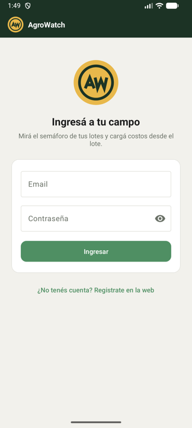
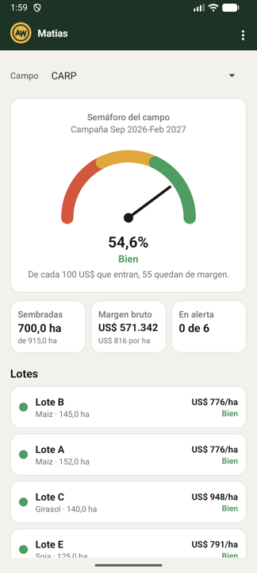
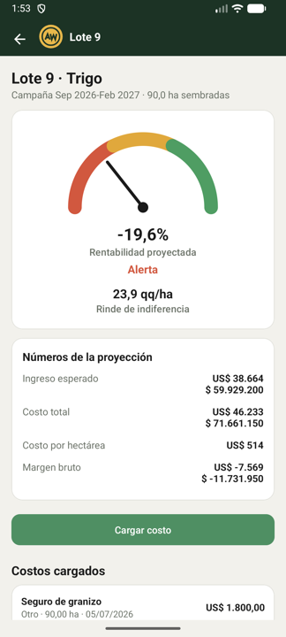
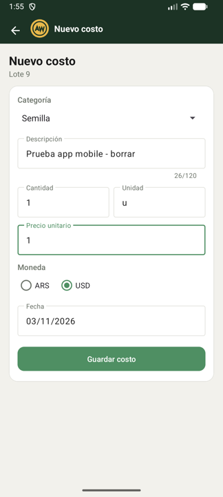
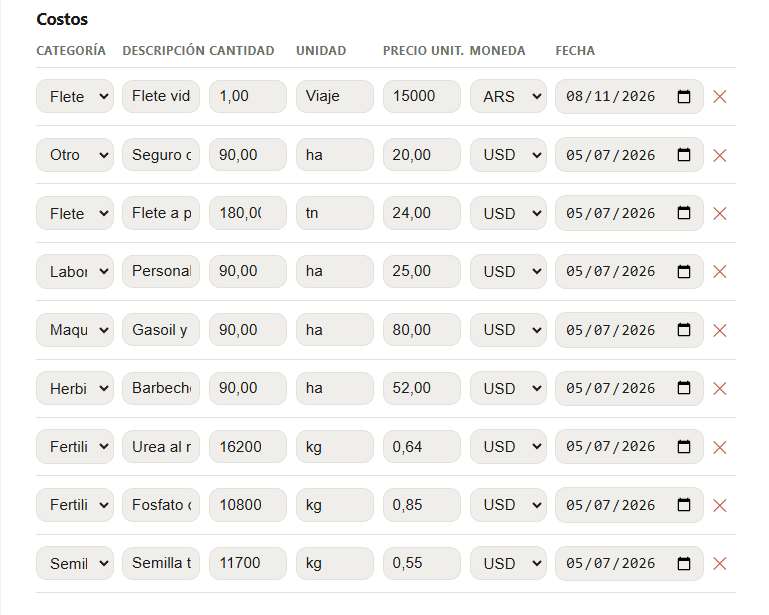
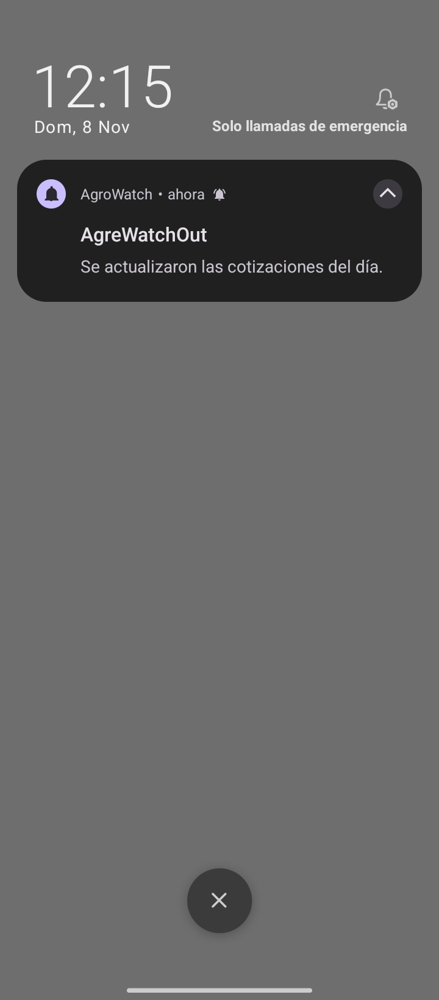
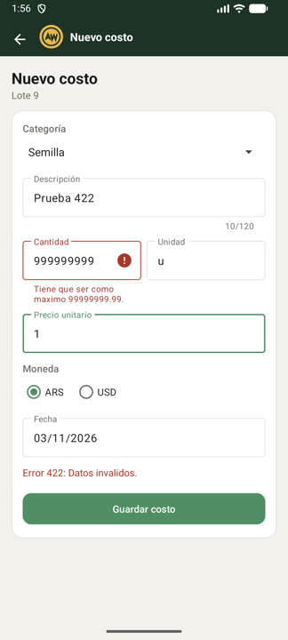
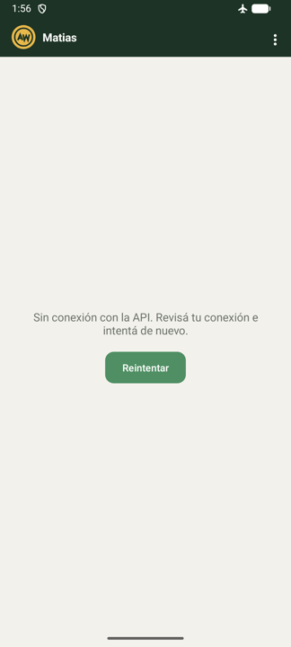

# AgroWatch Mobile

**El semáforo de tu campo en el bolsillo.** App Android de AgroWatchOut: el productor ingresa
con su cuenta, ve si sus lotes van a dejar plata, carga y borra costos desde el lote y recibe
avisos push. Usa la misma API y los mismos datos que el frontend web.

|                    |                                                                                                |
| --- | --- |
| **API**            | https://api-rest-agro.up.railway.app/api                                                       |
| **Frontend web**   | https://agrowatchout.up.railway.app                                                            |
| **Video**          | [Recorrido de la app (3 a 5min)](https://youtu.be/cxIcqkEsktM)                                 |
| **Backend**        | [agrowatch-api](https://github.com/harikirtandas/agrowatch-api), desplegado en Railway (PaaS)  |
| **Materia**        | Aplicaciones Móviles y Cloud Computing (UPSO), Trabajo Práctico Integrador N.º 2               |
| **Docentes**       | Eduardo Mónaco y Heber Alonso                                                                  |
| **Grupo**          | 1                                                                                              |
| **Integrantes**    | Jorge Bianchi, Gabriel R. Iglesias, Marcos San Román, Camila Ailén Rodríguez y Facundo Curiman |

## Índice

1. [Presentación](#1-presentación)
2. [Cómo correrla](#2-cómo-correrla)
3. [Pantallas](#3-pantallas)
4. [Endpoints que usa la app](#4-endpoints-que-usa-la-app)
5. [Servicio cloud](#5-servicio-cloud)
6. [Decisiones de diseño](#6-decisiones-de-diseño)
7. [Limitaciones conocidas](#7-limitaciones-conocidas)

## 1. Presentación

**Tema:** economía agraria. AgroWatchOut responde, mientras el cultivo todavía está en el lote,
la pregunta que el productor se hace al cierre de la campaña: **¿lo que sembré me es rentable?**
La API calcula el margen bruto proyectado, el rinde de indiferencia y un semáforo de
rentabilidad con el precio del grano y el dólar del día.

La app es la versión mobile **simple** del frontend web. No lo replica: toda la configuración
(registro, establecimientos, lotes, campañas y siembras) sigue haciéndose en la web. En el
teléfono el productor hace lo que necesita en el campo:

- ver el semáforo de cada establecimiento y cuáles lotes están en riesgo;
- ver los números de un lote: margen, costos y rinde de indiferencia;
- **cargar un costo** apenas lo tiene (el gasoil, el flete, el fertilizante) y ver cómo cambia
  el semáforo;
- **borrar un costo** cargado por error, con un toque largo sobre él;
- **recibir avisos** en el teléfono aunque la app esté cerrada (sección 5).

Mantiene la identidad del frontend web: la misma paleta, el logo AW, el velocímetro del
semáforo con sus colores y los mismos textos («Bien», «Ajustado», «Alerta»).

**Usuario de prueba:** el mismo del frontend web, en la
[sección 2 del README de la API](https://github.com/harikirtandas/agrowatch-api#2-usuario-de-prueba).
También va en el envío del campus.

## 2. Cómo correrla

**Requisitos:** Android Studio, un emulador o teléfono con Android 7.0 (API 24) o superior y
conexión a Internet. Probada en el emulador **Medium Phone con Android API 37**.

1. Clonar el repositorio.
2. En Android Studio: **File → Open** y elegir la carpeta del proyecto.
3. Esperar el Gradle Sync y ejecutar el módulo `app`.

**La URL de la API está en un solo lugar:** la constante `URL_BASE` de
[`ApiCliente.java`](app/src/main/java/com/example/agrowatchmobile/api/ApiCliente.java). Apunta
al despliegue de Railway por HTTPS; no hace falta cambiarla para probar la app.

**APK:** `app/build/outputs/apk/debug/app-debug.apk`, generada con
**Build → Build App Bundle(s) / APK(s) → Build APK(s)**.

**Tests:** la lógica del semáforo tiene tests de unidad, que se corren con
`./gradlew testDebugUnitTest`.

**FCM:** el archivo `google-services.json` ya está en `app/`, así que no hay que hacer nada
extra para que compile. Qué es y cómo generarlo de nuevo está en la
[sección 5](#5-servicio-cloud).

## 3. Pantallas

| Activity | Qué muestra | Desde dónde se llega y qué recibe |
| --- | --- | --- |
| `LoginActivity` | Logo, email y contraseña. Ingresa con `POST /auth/login` y guarda el token. Un enlace abre el registro en la web | Es la pantalla de inicio. Si ya hay una sesión guardada pasa directo al panel. Hace `finish()`, así Atrás no vuelve a ella |
| `PanelActivity` | Selector de campo (solo si hay más de uno), el velocímetro con el semáforo del campo, tres indicadores (hectáreas sembradas, margen bruto, lotes en alerta) y la lista de lotes, del peor al mejor | Desde el ingreso. Sin extras: el campo elegido queda guardado en la sesión |
| `LoteActivity` | El semáforo del lote, el rinde de indiferencia, los números de la proyección y los costos cargados. Botón **Cargar costo**. Un toque largo sobre un costo pide confirmación, con la descripción y el importe, y lo borra | Desde un lote del panel. Recibe el extra `siembra_id` (el id que se pide a la API) y `lote_nombre` |
| `NuevoCostoActivity` | Formulario del costo: categoría, descripción, cantidad, unidad, precio, moneda y fecha. Valida antes de enviar y hace el `POST` | Desde el lote, con la **Activity Result API**. Recibe `siembra_id` y `lote_nombre`; si la API guarda el costo devuelve `RESULT_OK` y el lote se vuelve a cargar |

  
  
  
  

**El mismo costo en el front web y un aviso de FCM:**

  
  

### Video

Recorrido de la app de 3 a 5 minutos, sin voz y con textos en pantalla: cada pantalla, el alta de un costo y el mismo dato en la web, el borrado del costo, un error de validación y uno de la API,
el giro de pantalla y Atrás, la app sin conexión y una notificación de FCM.
**[Ver el video](https://youtu.be/cxIcqkEsktM)**

## 4. Endpoints que usa la app

Todos existían para el frontend web: **la app no agrega ni modifica endpoints**. Todos salvo el
ingreso llevan `Authorization: Bearer <token>`.

| Método | Ruta | Para qué la usa la app |
| --- | --- | --- |
| POST | `/auth/login` | Ingresar: devuelve `token`, `expira` y `usuario` |
| POST | `/auth/logout` | Salir: invalida el token en la API |
| GET | `/establecimientos` | Los campos del usuario, para el selector del panel |
| GET | `/campanias` | Elegir la campaña abierta más reciente, igual que la web |
| GET | `/lotes?establecimiento_id={id}` | Los lotes del campo elegido |
| GET | `/siembras?campania_id={id}` | Las siembras de la campaña, que se cruzan con los lotes |
| GET | `/siembras/{id}` | El detalle de una siembra: lote, cultivo, campaña y hectáreas |
| GET | `/siembras/{id}/margen` | El semáforo y los números de cada lote |
| GET | `/siembras/{id}/costos` | Los costos cargados en el lote |
| POST | `/siembras/{id}/costos` | **Alta de un costo desde la app** |
| DELETE | `/costos/{id}` | **Borrar un costo desde la app**: toque largo sobre el costo en el lote |

Las tres operaciones que pide la consigna: **listar** (lotes y costos), **crear** (costo) y
**detalle por id** (siembra). Además se puede **borrar** un costo. El costo cargado o borrado
desde la app queda en la misma base y cambia el margen del lote, que es lo que muestra el
frontend web.

## 5. Servicio cloud

El servicio cloud de la app es **Firebase Cloud Messaging (FCM)**, de Google: notificaciones
push que llegan al teléfono aunque la app esté cerrada.

**Por qué hace falta un servicio así.** Android cierra las apps que quedan en segundo plano
para ahorrar batería, así que una app no puede quedarse esperando un aviso del servidor. En
su lugar, el sistema mantiene **una sola conexión para todo el teléfono**, que administra
Google Play Services y comparten todas las apps instaladas. FCM es la puerta de entrada a esa
conexión.

**Por qué FCM y no Firebase Authentication.** La app ya tiene su ingreso, el de la API. Sumar
Authentication obligaría a ingresar dos veces y no protegería la API, que sigue verificando su
propio token. FCM no se superpone con nada, es gratis y no pide tarjeta.

### Cómo está integrado

| Pieza | Dónde | Qué hace |
|---|---|---|
| `AvisosService` | [`avisos/AvisosService.java`](app/src/main/java/com/example/agrowatchmobile/avisos/AvisosService.java) | Recibe el mensaje. Lo despierta el sistema, no una Activity nuestra |
| Canal `avisos` | el mismo archivo | Agrupa las notificaciones. Obligatorio desde Android 8: sin canal el sistema las descarta sin avisar |
| Permiso `POST_NOTIFICATIONS` | `PanelActivity` | Se pide al entrar al panel y no en el ingreso, para no interrumpirlo. Hace falta desde Android 13 |
| Suscripción al tema | `PanelActivity` | La app se anota en el tema `avisos` al entrar al panel |

Con la app **abierta**, Android no muestra nada por su cuenta: la notificación la arma
`onMessageReceived`. Con la app **en segundo plano** la muestra el sistema, y por eso el canal
y el ícono por defecto también van declarados en el `AndroidManifest.xml`.

El ícono de la barra es una silueta monocroma aparte ([`ic_aviso.xml`](app/src/main/res/drawable/ic_aviso.xml)):
Android enmascara ese ícono a blanco, así que el logo de la app se vería como una mancha.

### Qué datos salen de la app y hacia dónde

| Dato | Hacia dónde | Para qué |
|---|---|---|
| **Token de la instalación** | Servidores de Firebase (Google) | Es la dirección de esa copia de la app en ese teléfono. La genera Google, no la app, y cambia al reinstalar o borrar los datos |
| **Suscripción al tema `avisos`** | Servidores de Firebase (Google) | Deja anotado que ese teléfono quiere recibir los avisos |

**No sale nada más.** Al servicio cloud no se le manda el usuario, el email, el token de la
API, ni los campos, lotes o costos: todo eso viaja únicamente a la API propia. El token de FCM
tampoco se guarda ni se envía a la API, porque los avisos se mandan por tema y no por
dispositivo.

**Por qué por tema y no por token.** Enviar por token obliga a guardar la dirección de cada
teléfono en una base de datos y mantenerla al día. Con un tema, el teléfono se suscribe solo y
el envío se hace una vez al tema; Google se encarga de repartirlo.

### Cómo se mandan los avisos

En la consola de Firebase: **Messaging → New campaign → Notification**, con el título y el
texto; en **Target**, la pestaña **Topic** con el nombre `avisos`. Después **Review** y —lo
que es fácil pasar por alto— **Publish**: sin ese último paso la campaña queda en estado
*Draft* y no se envía.

### El `google-services.json`

Es el archivo que identifica a la app ante Firebase. Sin él, el plugin de Gradle corta la
compilación, así que **está versionado en este repositorio**, en `app/`, para que el proyecto
compile al clonarlo. El repositorio es público, así que cualquiera puede verlo.

Contiene el id del proyecto, el id de la app y una `api_key` de cliente. Esa clave viaja
dentro de la APK —cualquiera que instale la app puede leerla— y **no sirve para enviar
notificaciones**: enviar requiere una cuenta de servicio, que no está ni va a estar en el
repositorio. Igual conviene restringir la clave en Google Cloud Console a la app Android y a
las APIs de Firebase. Si los docentes prefieren que el archivo no esté en el repositorio, se
saca y se genera con los pasos de abajo.

Para generarlo de nuevo, o para apuntar la app a otro proyecto de Firebase:

1. En [console.firebase.google.com](https://console.firebase.google.com), crear un proyecto.
2. Registrar una app Android con el paquete `com.example.agrowatchmobile`. Tiene que ser
   exacto: con otro nombre el archivo se genera igual, pero las notificaciones no llegan.
3. Descargar el `google-services.json` y dejarlo en `app/`, al lado de `build.gradle.kts`.

## 6. Decisiones de diseño

**Cuatro pantallas, una por tarea.** El ingreso, el panel (todo el campo), el lote (uno solo) y
el alta del costo. Cada Activity tiene una sola responsabilidad y la navegación es la de la
cursada: Intents con extras hacia adelante y la Activity Result API para volver con el
resultado del alta. Lo que en la web es configuración no está en la app, para que siga siendo
simple.

**La API descrita en un solo lugar.** `AgroApi` es la interfaz de Retrofit con todos los
endpoints y `ApiCliente` arma el cliente una sola vez, con la URL base. Sobre el modelo de
AppAlumnos se agregaron dos cosas que pide esta API:
- un interceptor que suma `Authorization: Bearer` a cada pedido, como hace `api.js` en la web;
- una política de Gson que traduce el `snake_case` de la API (`ha_sembradas`) al `camelCase`
  de los modelos (`haSembradas`), sin anotar campo por campo.

**Manejo de errores centralizado.** `LlamadaApi` es el `Callback` de Retrofit con las decisiones
de siempre ya tomadas, para no repetirlas en cada pantalla:
- `onFailure` significa que no hubo respuesta: se muestra «Sin conexión con la API».
- `onResponse` con error muestra el `mensaje` de la API (400, 404, 422). En un 422 marca cada
  campo con lo que la API dice que está mal.
- En Nuevo costo, el aviso de un campo se borra apenas se escribe en él. Cuando no queda
  ningún aviso, también se oculta el mensaje de abajo. «Sin conexión con la API» no marca
  campos, así que sigue visible hasta que se vuelve a tocar Guardar.
- Al borrar un costo, si la API responde 404 (ya lo habían borrado, por ejemplo desde la web),
  se avisa y se vuelve a pedir la lista para que deje de aparecer.
- Un 401 cierra la sesión y vuelve al ingreso.
- Si la Activity ya se cerró, por ejemplo porque se giró la pantalla, la respuesta se ignora.

`ErrorApi` lee el formato de error de esta API: `{"error": {"status", "mensaje", "errores"}}`.

  
  

**El semáforo del campo se calcula en la app.** La API calcula el margen de cada lote; el del
campo entero lo arma el frontend web en `dashboard.js`. Para que la app muestre los mismos
números, esa lógica se pasó a Java (`ResumenCampo` y `Semaforo`, con el mismo umbral del 20 %) y
tiene tests de unidad.

**Girar la pantalla.** Las pantallas que solo leen vuelven a pedir los datos en `onCreate`, que
es el criterio de la cursada. El alta del costo es la excepción: el `POST` vive en un
`ViewModel`, que sobrevive al giro. Así el pedido en curso no se pierde y el botón sigue
deshabilitado: no se puede mandar dos veces el mismo costo.

Al girar, el formulario conserva lo escrito, los avisos de los campos y el mensaje de abajo. El
error de la API se muestra una sola vez (después el `ViewModel` vuelve a `LIBRE`), así que un
campo del 422 que el usuario ya corrigió no se vuelve a marcar al girar.

**Identidad visual.**
- La paleta de `colors.xml` usa los mismos nombres que las variables CSS de la web.
- El logo es `logo-aw.svg` pasado a Vector Drawable.
- El velocímetro es una View propia (`GaugeView`) que dibuja los arcos del `<svg>` de la web con
  los mismos ángulos.
- La tipografía es Roboto, que es la que la pila de fuentes de la web termina usando en Android.

**Librerías:**
- **Retrofit 2.11 con Gson**, la versión de la cursada;
- **Lifecycle** (`ViewModel` y `LiveData`), para el alta;
- **Material Components**, para el tema, las tarjetas y los campos de texto;
- **Firebase Cloud Messaging**, con la BoM de Firebase 35.1.0 y el plugin google-services
  4.5.0, para los avisos push.

Las fechas usan `SimpleDateFormat` y no `java.time`, que necesita Android 8.0 y la app arranca
en Android 7.0.

## 7. Limitaciones conocidas

- **Los avisos se mandan a mano desde la consola de Firebase.** La app los recibe; falta que
  los dispare la API al sincronizar cotizaciones, que en el
  [PLAN.md](PLAN.md#servicio-cloud-fcm-r4) figura como opcional.
- **Tocar un aviso que llegó con la app abierta no hace nada:** no abre la app ni se borra de
  la barra. Los que llegan con la app en segundo plano sí abren la app.
- **Si el usuario rechaza las notificaciones, el permiso se vuelve a pedir** cada vez que se
  abre el panel, hasta que Android lo bloquea solo después del segundo rechazo.
- **No se pueden editar costos desde la app**: se hace desde la web. La API ya tiene
  `PUT /costos/{id}`, así que agregarlo es posible.
- **Al volver al panel se vuelven a pedir todos los datos**, incluido el margen de cada lote:
  un pedido por lote con siembra. Con muchos lotes la carga tarda más.
- **Sin modo oscuro:** la web tampoco lo tiene.
- **El ícono de la app es el del logo solo desde Android 8.0.** En 7.0 y 7.1 se ve el ícono por
  defecto de Android Studio.
